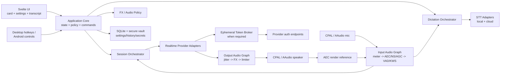

# Realtime Voice Cockpit — Design

## 0. Design role

This is the **how** layer derived from `requirements.md`. It does not weaken the contracts in that document. Where an implementation choice later fails measurement, the choice may be replaced while the requirement IDs remain stable.

The design target is a product that feels like one tiny audio instrument rather than four API demos taped together: the microphone and UI remain stable while providers, models, voices, turn strategies, and output transformations can be swapped.

---

## 1. Architecture decision

### 1.1 Selected stack

**Application shell:** Tauri 2  
**Frontend:** Svelte 5 + TypeScript + Vite  
**Package manager:** pnpm workspace  
**Native/core:** Rust  
**Audio I/O:** CPAL  
**Async runtime:** Tokio outside realtime callbacks  
**Local speech primitives:** sherpa-onnx through a narrow native adapter  
**Echo/noise/gain:** WebRTC Audio Processing where viable, with platform-native processing allowed behind the same contract  
**Pitch/time/formant:** Signalsmith Stretch, with small native DSP stages for gain/EQ/ring modulation/bit reduction/delay  
**Audio decode for transcription:** Symphonia for supported audio containers/codecs  
**Secret store:** Tauri Stronghold, with platform-bound vault password derivation/biometric gating where practical  
**Local metadata/history:** SQLite through Rust/sqlx or Tauri SQL, with raw audio stored as files only when retention is enabled  
**Token broker:** Hono + TypeScript; deployable as a Cloudflare Worker, Vercel function, or a small Bun service  
**Desktop updates:** Tauri updater with signed metadata/artifacts  
**Tests:** Rust unit/integration tests + provider wire fixtures + Svelte component/state tests + credential-gated provider smoke suite

This matches REQ-001 through REQ-006 and REQ-107 through REQ-118.

### 1.2 Why Tauri rather than Electron, PySide, Flutter, or separate native apps

Tauri 2 is selected because the current toolchain supports Windows, Linux, and Android while allowing:
- one Svelte UI and state machine;
- Rust-owned low-latency audio;
- native Kotlin additions on Android only where Android lifecycle APIs demand them;
- global-shortcut/tray/window integrations on desktop;
- a smaller runtime footprint than Electron;
- no Python runtime/package management on user machines;
- clean sharing of provider protocol and DSP code across desktop and Android.

Electron/OpenDex is useful as UX reference but makes Android a second implementation. RoomKit UI is a highly relevant desktop reference, but PySide/Python similarly creates a mobile fork. Flutter could cover desktop/mobile, but the project would still need substantial Rust/C++ FFI for the chosen audio/DSP stack and does not align as closely with the desired Svelte/Rust development stack.

### 1.3 WSL2 decision

WSL2 is **not an RVC runtime platform for audio ownership**. On a Windows laptop:
- install `realtime-voice-cockpit.exe`;
- let Windows own WASAPI microphone/speaker, global hotkeys, tray, foreground focus, and text injection;
- expose a localhost named-pipe/TCP/CLI bridge so WSL shells can run actions such as `rvc start`, `rvc dictate`, `rvc mute`, or `rvc provider openai`;
- optionally put a tiny Linux `rvc` shim in WSL that forwards to `rvc.exe`.

This keeps the same workflow available from WSL without building correctness on WSLg desktop/audio behavior.

---

## 2. System decomposition



### Authority boundaries

1. **Realtime audio thread**
   - owns only bounded PCM movement and realtime-safe DSP;
   - never touches database, UI, HTTP, DNS, filesystem, or token logic.

2. **Audio worker**
   - resampling, local VAD/KWS inference, non-callback DSP coordination;
   - communicates through bounded lock-free or bounded async queues.

3. **Session worker**
   - WebRTC/WebSocket lifecycle;
   - provider event translation;
   - cancellation/reconnect/session rotation.

4. **Application core**
   - product state machine;
   - provider/model/voice selection;
   - command routing;
   - privacy/retention policy.

5. **UI**
   - renders state;
   - never owns credentials or provider socket details.

6. **Token broker**
   - separate deployable trust boundary;
   - has master provider secrets only when ephemeral credential minting requires them;
   - returns narrow, short-lived credentials, never a master key.

---

## 3. Monorepo layout

```text
realtime-voice-cockpit/
├── apps/
│   └── cockpit/
│       ├── src/                         # Svelte UI
│       ├── src-tauri/
│       │   ├── src/                     # Rust application commands
│       │   ├── capabilities/            # Tauri permissions
│       │   ├── gen/android/             # generated Android host
│       │   └── tauri.conf.json
│       └── package.json
├── crates/
│   ├── rvc-core/                        # state machines and product policy
│   ├── rvc-audio/                       # CPAL streams, ring buffers, meter
│   ├── rvc-audio-processing/            # AEC/NS/AGC/VAD/KWS
│   ├── rvc-audio-fx/                    # EQ/stretch/formant/presets/limiter
│   ├── rvc-provider-api/                # provider-neutral contracts
│   ├── rvc-provider-openai/
│   ├── rvc-provider-gemini/
│   ├── rvc-provider-qwen/
│   ├── rvc-provider-xai/
│   ├── rvc-provider-generic/
│   ├── rvc-stt/                         # local/cloud STT contracts
│   ├── rvc-media/                       # audio-file decoding/segmentation
│   ├── rvc-storage/                     # SQLite/history/settings
│   ├── rvc-secrets/                     # Stronghold abstraction
│   ├── rvc-ipc/                         # desktop CLI/WSL bridge
│   └── rvc-testkit/                     # wire fixtures + audio fixtures
├── services/
│   └── token-broker/
│       ├── src/
│       ├── wrangler.toml
│       └── package.json
├── packages/
│   ├── contracts/                       # generated/shared TS DTOs
│   └── ui/                              # reusable Svelte UI primitives
├── evals/
│   ├── provider/
│   ├── audio/
│   ├── security/
│   └── platform/
├── requirements.md
├── design.md
├── pnpm-workspace.yaml
└── Cargo.toml
```

The provider crates depend inward on `rvc-provider-api`; UI does not import provider crates. `rvc-audio-fx` does not know which provider generated the samples. This is the central anti-lock-in rule behind REQ-085 through REQ-087.

---

## 4. Product state model

The canonical state is provider-neutral.

### Top-level runtime state

- `idle`
- `arming-wake`
- `wake-armed`
- `connecting`
- `ready`
- `listening`
- `committing`
- `awaiting-response`
- `speaking`
- `interrupted`
- `reconnecting`
- `rate-limited`
- `auth-failed`
- `fatal`

### Orthogonal flags

- mic muted/unmuted;
- wake enabled/disabled;
- dictation active/inactive;
- provider session active/inactive;
- model output FX bypassed/enabled;
- recording retention off/on;
- local-only audio path/remote path;
- card collapsed/expanded.

Do not encode states such as `openai_server_vad_waiting`; adapters translate those events into product state plus diagnostics metadata.

### Critical transitions

`idle -> wake-armed`  
starts local microphone + KWS only.

`wake-armed -> connecting`  
triggered by keyword or summon action if no warm provider session exists.

`ready -> listening`  
local input opens to selected turn policy.

`speaking -> interrupted`  
local confirmed speech or explicit stop cancels local playback first, then issues provider cancellation/truncation.

`interrupted -> listening`  
after render queue is flushed and input gate is opened.

`any-active -> reconnecting`  
only for retryable errors; bounded policy applies.

`auth-failed -> idle/settings`  
never retry credentials in a tight loop.

---

## 5. Provider abstraction

Each adapter implements five conceptual contracts.

### 5.1 Provider descriptor

Fields:

| Field | Meaning |
|---|---|
| `provider_id` | stable product ID: `openai`, `gemini`, `qwen`, `xai`, custom |
| `display_name` | UI label |
| `model_catalog` | known defaults plus custom-string permission |
| `transports` | WebRTC, WebSocket, HTTP request, AOQ |
| `auth_modes` | OAuth, API key, ephemeral token, broker token |
| `input_audio` | accepted codec/sample-rate/channel combinations |
| `output_audio` | emitted codec/sample-rate/channel combinations |
| `turn_modes` | manual/server-vad/smart-turn/provider-specific normalized set |
| `supports_barge_in` | native cancel/truncate semantics |
| `voice_semantics` | runtime/pre-audio/session-only |
| `session_limits` | known duration/turn/context bounds |
| `usage_events` | what usage data can be trusted |
| `transcription` | dedicated/live/file STT capability |
| `endpoint_schema` | which URLs/headers are overrideable |

### 5.2 Credential provider

The adapter asks a credential service for one of:
- trusted API key;
- OAuth access token;
- provider ephemeral client secret;
- broker-minted temporary token.

It never reads Stronghold directly.

### 5.3 Realtime session

Normalized commands:
- connect;
- configure session;
- append/stream microphone frames;
- commit turn;
- cancel response;
- truncate assistant audio if supported;
- send text;
- update instructions/tools where supported;
- close.

Normalized events:
- connected;
- user-speech-started;
- user-speech-ended;
- input-transcript-delta/final;
- response-started;
- response-text-delta/final;
- response-audio;
- usage;
- provider-warning;
- session-limit;
- error;
- closed.

### 5.4 Audio codec bridge

Every provider adapter converts its network representation to/from an internal float PCM representation. Provider sample-rate peculiarities stop at the adapter boundary.

### 5.5 Session capability guard

Before a command is sent, the adapter validates it against the active model descriptor. For example, a `set_voice` request on a session-only voice provider is converted into a deliberate restart request rather than silently ignored.

---

## 6. Provider-specific design

## 6.1 OpenAI

Baseline:
- `gpt-realtime-2.1`
- `gpt-realtime-2.1-mini`

Transport policy:
- prefer WebRTC for interactive client use;
- keep a WebSocket transport for desktop/server-style debugging and gateways;
- isolate WebRTC signalling from media callbacks.

Authentication:
- **desktop trusted mode:** API key may be held in encrypted local vault and used by native Rust, never exposed to Svelte DOM/JS;
- **recommended desktop/mobile mode:** call the token broker to mint a short-lived Realtime client secret, then connect directly;
- **Android:** ephemeral client secret path is the production default;
- do not implement “ChatGPT login as API OAuth” because no public third-party API OAuth contract is being relied upon.

Model switching:
- create new Realtime session unless a documented session update can safely perform the requested change;
- carry a bounded local transcript into the new session according to user context policy.

Transcription:
- keep conversation transcription separate from dedicated dictation/STT selection so a user may choose a cheaper/faster transcription model.

## 6.2 Gemini

Baseline:
- `gemini-3.1-flash-live-preview`

Authentication options:
1. official Google OAuth 2.0 for user-configured Google Cloud credentials;
2. API/authorization key fallback;
3. ephemeral Live tokens for client-safe direct sessions where used.

The UI should actually label these:
- `Google OAuth`
- `Gemini key`
- `Brokered ephemeral token`

Do not call all three “OAuth”.

Transport:
- native Live API bidirectional WebSocket.
- adapter translates Gemini setup/content/tool/audio messages into the common event stream.

OAuth:
- desktop uses system browser authorization;
- Android uses platform browser/custom tab and deep-link callback;
- tokens are persisted only in the secret vault;
- refresh occurs off the realtime audio thread.

## 6.3 Alibaba/Qwen

First class:
- `qwen-audio-3.0-realtime-plus`
- `qwen-audio-3.0-realtime-flash`

Capability-compatible optional current family:
- `qwen3.5-omni-plus-realtime`
- `qwen3.5-omni-flash-realtime` when exposed in the selected region/workspace.

Transport:
- WebSocket is the broad, simple baseline;
- AOQ temporary-token path is supported as a brokered client-safe mode;
- WebRTC is exposed only when the user’s account/endpoint supports it.

Important adapter behavior:
- region/workspace forms part of the endpoint profile;
- API keys are region/workspace scoped in practice and must not be assumed portable;
- `qwen-audio-3.0-realtime-*` accepts PCM input at 16 kHz mono 16-bit and emits PCM at 24 kHz mono 16-bit according to current docs;
- voice is session-level for Qwen Audio 3.0, so changing it forces a controlled new session;
- current system voices are discoverable/configurable, and arbitrary cloned voice IDs are allowed where the account supports them;
- provider session audio-turn/duration limits become a countdown/rotation hint rather than a surprise disconnect.

Authentication:
- direct API key only on a trusted native host;
- AOQ token via broker for Android/client-safe mode;
- do not fabricate Alibaba consumer OAuth.

## 6.4 xAI

Baseline:
- `grok-voice-latest`

Transport:
- WebSocket.

Authentication:
- trusted native desktop may use vault-held API key;
- browser/mobile-style connections use an xAI ephemeral client secret minted by broker;
- Android defaults to ephemeral;
- no fake consumer OAuth.

Turn handling:
- normalize xAI server VAD events;
- local VAD still drives immediate UI/interruption gating.

## 6.5 Generic provider

The generic adapter is intentionally constrained. A profile must declare:
- protocol family;
- base/WS/SDP URLs;
- model;
- auth style;
- request headers;
- audio format;
- event mapping preset.

Initially support:
1. OpenAI-Realtime-compatible WebSocket event schema;
2. OpenAI-compatible request-response STT/TTS endpoints;
3. raw custom WebSocket only through an explicit mapping definition.

Do not allow arbitrary user JavaScript to execute inside the privileged app as a “provider plugin”.

---

## 7. Token broker

### 7.1 Purpose

The broker exists because an Android APK, browser WebView, or any distributable client cannot safely contain a long-lived provider master key. It is not a general proxy and should not carry realtime audio unless a provider gives no safer direct-client credential path.

### 7.2 Deployment targets

One Hono codebase:
- Cloudflare Worker preferred for public lightweight deployment;
- Vercel serverless/edge deployment supported;
- Bun service supported for LAN/self-hosted use.

### 7.3 Endpoints

- `POST /v1/session-token/openai`
- `POST /v1/session-token/gemini`
- `POST /v1/session-token/qwen`
- `POST /v1/session-token/xai`
- `GET /healthz`

Requests contain only the minimum provider/model/session restrictions needed to mint a credential.

### 7.4 Broker authentication

For a personal deployment, support either:
- a random per-install broker access credential stored in Stronghold;
- or a user-authenticated deployment in a later phase.

Never expose the provider master key back to the app.

### 7.5 Abuse limits

- per-client rate limit;
- provider/model allowlist;
- short token TTL;
- maximum token-mint frequency;
- origin/device binding where provider semantics allow;
- no wildcard CORS in public deployment;
- audit only token-mint metadata, never raw secret or audio.

---

## 8. Audio engine

## 8.1 Internal format

Use interleaved or planar `f32` PCM internally, with explicit:
- sample rate;
- channels;
- frame timestamp;
- monotonic capture sequence;
- source kind.

Network/provider codecs are converted at adapter boundaries.

## 8.2 Capture

CPAL backend:
- Windows: WASAPI;
- Linux: ALSA/PipeWire/PulseAudio backend selection according to detected environment;
- Android: AAudio.

Capture callback writes frames into a bounded lock-free ring buffer. If the consumer falls behind:
- increment overrun metric;
- drop oldest/newest according to mode;
- never block the callback.

## 8.3 Input graph

Default order:

1. raw level meter tap;
2. high-pass/DC removal if enabled;
3. AEC using speaker render reference;
4. noise suppression;
5. AGC;
6. processed meter tap;
7. local VAD;
8. keyword spotter when wake mode needs it;
9. pre-roll ring buffer;
10. provider/STT resampler/encoder.

The KWS receives processed audio but the UI can display both raw and processed meter values.

## 8.4 Output graph

1. provider packet/jitter buffer;
2. decode/resample into internal PCM;
3. session cancellation gate;
4. gain;
5. EQ;
6. pitch/time/formant engine;
7. character effect stages;
8. optional reverb/delay/chorus;
9. limiter;
10. final meter;
11. speaker output ring;
12. copy of pre-speaker render signal to AEC reference.

When interruption occurs, stage 3 invalidates queued assistant frames by generation ID so stale buffered speech cannot leak out after cancel.

---

## 9. Meter and waveform

Two visualizations are useful, and both should be available in the card:

### Level bar / orb

Derived from a short RMS window plus peak hold:
- RMS drives fill/energy;
- peak drives a thin peak marker;
- clipping sets a persistent warning for a short decay interval;
- VAD speech state changes outline/icon rather than relying only on color.

### Short waveform

Keep only a downsampled visualization ring, not the full microphone signal. Send 20–30 visualization frames/sec to Svelte. The UI never receives every audio sample.

Diagnostic mode can show:
- raw RMS;
- processed RMS;
- noise floor;
- VAD probability;
- KWS score;
- AEC enabled/state;
- input/output device;
- current sample rates.

---

## 10. Wake word design

Use sherpa-onnx keyword spotting as the default cross-platform local engine because the same project supports desktop and Android and allows custom keyword definitions with small models.

Pipeline states:
- wake disabled: no KWS;
- wake armed: local capture + processing + KWS only;
- wake detected: play optional short earcon, preserve configurable pre-roll, establish or unmute realtime provider session;
- refractory window: ignore repeated activations for a bounded interval.

Recommended default policy:
- wake sensitivity conservative;
- 250–500 ms speech pre-roll;
- 750–1200 ms refractory period after trigger;
- provider connection starts on confirmed wake unless “keep warm” is enabled.

“Keep warm” is opt-in because it may create cost/privacy implications even if audio is gated.

Android:
- always-listening wake requires an explicit foreground service and visible notification;
- if the user disables the foreground service, wake works only while the app is foreground/otherwise permitted by Android;
- ship a notification stop button that fully releases the microphone.

---

## 11. Turn and interruption design

### 11.1 Four policies

**Immediate**  
First confident local speech frame while assistant audio is playing:
- mute/cancel output instantly;
- notify provider.

Best for headphones/clean audio.

**Confirmed**  
Require speech probability above threshold for a configurable duration, default around 250 ms.
- AEC greatly reduces false positives.
- this should be the desktop loudspeaker default.

**Provider-smart**  
Use provider semantic/smart-turn endpoint logic for turn completion while still using local VAD for meter and fast playback gating.

**Disabled/manual**  
No automatic commit/interruption.

### 11.2 Barge-in sequence

1. local VAD begins candidate speech;
2. AEC-filtered confirmation threshold passes;
3. output gate flushes current generation;
4. provider `cancel`/equivalent is sent;
5. if provider supports assistant-audio truncation, report amount already heard;
6. microphone pre-roll is appended so the first phoneme is not lost;
7. UI transitions `speaking -> interrupted -> listening`.

This ordering prioritizes what the user hears. Waiting for a cloud acknowledgement before muting local playback would make interruption feel sluggish.

### 11.3 Backchannels

A later semantic classifier may ignore “mm-hm”, laughter, or coughs. V1 can expose:
- immediate;
- duration-confirmed;
- provider-smart.

Do not ship an unvalidated local semantic backchannel classifier as a hidden default.

---

## 12. Output FX design

## 12.1 Engine choice

Signalsmith Stretch is selected for pitch/time/formant operations because it is MIT licensed, supports pitch and time independently, includes Web Audio/C++ implementations, and exposes formant compensation support in the current project history.

Use a small in-house realtime-safe DSP layer for:
- gain;
- biquad EQ;
- soft/hard limiter;
- ring modulation;
- bit reduction;
- short delay;
- simple chorus;
- wet/dry routing.

Avoid Rubber Band in the default binary because its GPL/commercial licensing complicates distribution. SoundTouch remains a fallback benchmark.

## 12.2 Parameter domains

- gain: `-24 dB` to `+12 dB`, output limiter always after;
- pitch: default user range `-12` to `+12` semitones, expert range up to library-safe limits;
- tempo: default `0.75x` to `1.5x`;
- formant shift/compensation: engine-supported normalized control;
- EQ: low shelf, parametric mid bands, high shelf;
- ring mod: bounded frequency/depth;
- bit depth/sample reduction: bounded so presets remain intelligible;
- delay/reverb: low-latency short settings by default.

## 12.3 Factory presets

These are product presets, not provider voices.

### Clean
- gain 0 dB;
- flat EQ;
- pitch 0;
- tempo 1.0;
- limiter on.

### Robot
- pitch 0;
- tempo 1.0;
- moderate ring modulation;
- narrowed mid-focused EQ;
- mild bit reduction;
- very short metallic delay;
- limiter.

### Bunny
- pitch approximately +5 to +7 semitones;
- formant shifted/preserved toward a lighter timbre;
- high shelf lift;
- slight tempo increase around 1.04–1.08x;
- no harsh ring modulation.

### Scary
- pitch approximately -4 to -7 semitones;
- formant darkening;
- low shelf lift with controlled sub-bass;
- mild chorus/double delay;
- slight tempo reduction around 0.92–0.98x.

### Pixie
- pitch approximately +3 to +5 semitones;
- formant lift;
- high shelf sparkle;
- very short stereo-like chorus where output is stereo;
- tiny bright delay/reverb;
- tempo near 1.0–1.05x.

Factory exact values are tuned against recorded speech fixtures before 1.0 and then versioned. User presets clone the factory graph rather than mutate shipped definitions.

## 12.4 Pitch correction terminology

The requested “with/without pitch correction” is represented as two distinct controls:
- **preserve pitch while changing tempo**;
- **preserve/compensate formants while changing pitch**.

For spoken voice there is no musical “autotune” pitch correction in V1. A musical pitch-quantizer is a future effect because normal speech does not have a single stable note to correct.

---

## 13. Dictation architecture

Dictation is a sibling of realtime conversation, not a mode inside a provider session.

### Hold-to-dictate

Desktop hotkey pressed:
- remember previously focused app;
- begin local capture;
- show mini meter;
- release commits;
- run selected STT;
- normalize text;
- copy/paste according to destination policy.

### Toggle dictation

First key:
- start capture.
Second key:
- stop/commit.

### Live captions

- streaming STT path;
- partial text stays visually distinct;
- finalized segments append to stable transcript.

### STT providers

At minimum:
- `local-sherpa` using a current English model selected from managed assets;
- OpenAI dedicated transcription adapter;
- Gemini dedicated live/file transcription adapter where current API supports it;
- Qwen ASR realtime/file adapter;
- xAI STT adapter.

The STT provider is configured separately from the realtime conversation provider. A user can talk to Grok but dictate through local Parakeet/Qwen ASR, for example.

---

## 14. File transcription

### Input

Use native file picker and persist only a granted path/scope.

Symphonia handles common audio formats. Decode incrementally and normalize to the STT engine’s expected format.

### Long-file processing

Pipeline:
1. open/decode stream;
2. optional VAD segmentation;
3. bounded chunk queue;
4. transcribe with limited concurrency;
5. merge timing offsets;
6. write progress/checkpoint metadata;
7. export.

Cancellation stops new chunks and cancels provider requests where possible.

### Result model

Each transcript contains:
- source filename;
- source duration;
- engine/provider/model;
- language when known;
- created time;
- segments;
- optional word timestamps;
- optional speaker labels;
- raw provider metadata in a namespaced field when useful.

Exports:
- `.txt`
- `.md`
- `.json`
- `.srt` when timestamps exist.

---

## 15. Desktop card design

### Collapsed card

Target approximately a small utility-card footprint rather than a chat window.

Contents:
- state glyph/text;
- microphone waveform or orb;
- provider/model abbreviated label;
- model voice + FX preset;
- mute;
- stop response;
- expand.

### Expanded card

Adds:
- live/final transcript;
- provider/model/voice selectors;
- turn mode;
- FX quick controls;
- latency indicators;
- session stop;
- transcript retention state.

### Settings window

Sections:
1. Audio devices and processing
2. Realtime providers
3. Provider authentication
4. Models and endpoints
5. Voices and FX
6. Wake and interruption
7. Dictation/STT
8. Hotkeys
9. Android/background behavior
10. Privacy/history
11. Diagnostics
12. Updates/about

### Desktop shortcuts

Independent registrations:
- summon/hide card;
- hold-to-dictate;
- toggle dictation;
- mute;
- stop response;
- start/stop realtime session.

If registration conflicts, show the conflicting binding and keep the previous valid configuration.

---

## 16. Linux behavior

### Audio

Prefer CPAL with the sound server actually in use:
- PipeWire where available;
- PulseAudio compatibility as necessary;
- ALSA as fallback.

Do not assume the ALSA `default` device is free when PipeWire/PulseAudio owns it.

### Global hotkeys and paste

Hotkey support is feature-detected.

Text injection:
- clipboard is always the baseline;
- X11 can use an XTest/desktop automation path;
- Wayland synthetic paste depends on compositor/protocol permissions;
- where paste injection is unavailable, copy text and raise a compact “copied” notification rather than report failure as transcription failure.

This separation matters: STT success and desktop injection success are different events.

### Packaging

Produce AppImage first plus `.deb` or Flatpak according to release infrastructure. Keep distro-specific audio dependencies documented by package.

---

## 17. Windows behavior

### Audio

CPAL/WASAPI default.

Use communications/default device roles where available and remember explicit user selection.

### Hotkeys

Use Tauri global shortcut on desktop. The Rust host owns registrations; Svelte only requests changes.

### Text injection

Use clipboard plus Windows input simulation through a small Rust platform module. Restore clipboard conditionally only if it has not changed since RVC set it.

### WSL bridge

Expose a named pipe or loopback port bound only to local host plus a random install token.

Commands:
- `status`
- `show`
- `hide`
- `session start`
- `session stop`
- `mute toggle`
- `dictate hold-start`
- `dictate hold-stop`
- `dictate toggle`
- `provider set`
- `model set`
- `voice set`
- `fx preset`
- `transcribe file`

The WSL shim invokes the Windows CLI with translated paths. For file transcription, convert `/mnt/c/...` paths to Windows paths before submission.

---

## 18. Android behavior

Tauri supplies the shared WebView/Rust application. A narrow Android plugin owns lifecycle-sensitive features.

### Android native plugin responsibilities

- microphone permission;
- foreground-service lifecycle for hands-free/wake;
- persistent notification actions;
- audio focus;
- Bluetooth/headset route changes;
- Quick Settings tile;
- media/headset button hooks where allowed;
- deep-link/OAuth callback;
- battery-optimization guidance screen;
- optional biometric unlock of the secret vault.

### Background wake

Never disguise background capture. When active:
- persistent system notification;
- visible “Mic active / wake armed” state;
- mute and stop actions;
- app card reflects foreground service state.

### Provider auth

Production default:
- OpenAI ephemeral client secret;
- Gemini OAuth or ephemeral Live token, depending configured method;
- Qwen AOQ temporary token/broker path when available;
- xAI ephemeral client secret.

A developer-only BYOK direct mode may exist behind an explicit warning and encrypted vault, but is not the release-default credential architecture.

---

## 19. Secret storage

Use Tauri Stronghold as the cross-platform application vault.

Store:
- provider API keys;
- OAuth refresh/access material;
- token broker credential;
- secret custom headers;
- optional encrypted export key material.

Do not store secrets in:
- Svelte localStorage;
- SQLite settings tables;
- plaintext TOML/JSON;
- logs;
- crash contexts.

The frontend receives opaque credential status such as:
- configured;
- missing;
- expired;
- refresh-required.

It does not receive the long-lived secret value after initial submission.

---

## 20. Persistence model

SQLite tables conceptually:

### `provider_profile`
- ID
- provider type
- display name
- model
- region/workspace
- endpoint overrides
- non-secret headers
- auth reference ID
- capability override flags
- created/updated

### `machine_settings`
- device IDs
- hotkeys
- card position
- autostart
- audio backend hints

### `audio_profile`
- AEC/NS/AGC
- VAD threshold
- interruption mode/window
- wake profile reference

### `fx_preset`
- name
- version
- ordered graph JSON
- factory/user flag

### `session`
- provider/model/voice
- started/ended
- termination reason
- local retention policy
- usage metadata
- latency summary

### `transcript_segment`
- session/transcription ID
- role/speaker
- start/end timestamps
- text
- final/partial state

### `transcription_job`
- source path metadata
- engine/model
- progress
- result/export references
- retention policy

Secrets are referenced by opaque IDs into Stronghold.

---

## 21. Configuration import/export

Portable export includes:
- provider non-secret profile;
- model strings;
- endpoints;
- prompts/instructions;
- wake/turn settings;
- FX presets;
- STT preferences.

It excludes:
- API keys;
- OAuth refresh tokens;
- broker credential;
- device IDs;
- machine hotkeys by default.

An explicit encrypted secret-bundle export can be designed later. It must never piggyback silently on normal settings export.

---

## 22. Audio asset management

Local KWS/STT assets have a manifest:
- model ID;
- version;
- architecture;
- download URL;
- SHA-256;
- license;
- expected unpacked size;
- engine compatibility;
- language;
- streaming/offline flags.

Downloads:
- use temporary partial file;
- verify hash;
- atomically rename;
- never execute model assets;
- expose storage usage and delete action.

For English local dictation, sherpa-onnx gives multiple viable model families, including current Parakeet/Qwen3 ASR conversions. Exact default should be selected by measured accuracy/RTF on the target laptops/Android phone rather than frozen from marketing.

---

## 23. Reconnection and session rotation

### Error classes

- authentication;
- authorization/model access;
- rate limit;
- invalid configuration;
- transient network;
- provider overload;
- protocol mismatch;
- audio device lost;
- local inference failure;
- broker failure.

### Retry

Retry automatically only for transient network/provider-overload classes.

Suggested bounded schedule:
- 0.5 s
- 1 s
- 2 s
- 4 s
- 8 s
- stop or ask after a bounded attempt count.

Do not auto-retry invalid API keys or unsupported model IDs.

### Rotation

If a provider advertises known session/audio-turn limits:
- warn before limit when possible;
- obtain next credential in parallel;
- create next session;
- carry bounded text context;
- swap only when ready;
- close old session.

Never overlap two paid sessions indefinitely.

---

## 24. Latency model

Collect separate timestamps rather than one misleading “latency” number.

### Input side
- capture callback timestamp;
- processing completed;
- first frame sent;
- turn commit sent.

### Provider
- commit acknowledged;
- response created;
- first text delta;
- first audio packet.

### Output
- first decoded frame;
- first post-FX frame;
- first speaker callback frame.

Displayed metrics:
- local capture/processing;
- endpoint/turn latency;
- first-audio latency;
- output buffer;
- underruns;
- FX buffering.

This makes it possible to see whether a sluggish session is network/provider, VAD, or local DSP.

---

## 25. Security model

### Threats explicitly handled

1. API key extracted from mobile package  
   Mitigation: broker + ephemeral credentials.

2. Secret leaked through logs  
   Mitigation: typed secret wrappers + redaction tests.

3. Malicious endpoint profile exfiltrates secret  
   Mitigation: credentials are scoped to provider profile and not automatically forwarded to arbitrary origins; custom endpoint secret use requires explicit association.

4. WebView compromise reads credentials  
   Mitigation: secrets live in Rust/Stronghold; frontend receives status/opaque IDs only.

5. Token broker used as free public minting endpoint  
   Mitigation: app-to-broker credential + rate limits + allowlist.

6. Ambient audio uploaded before wake  
   Mitigation: local gate and packet capture eval.

7. Model output triggers its own VAD/wake  
   Mitigation: AEC render reference, KWS/VAD gating, refractory rules.

8. Imported media parser attack  
   Mitigation: bounded decoder inputs, maintained Rust decoding stack, file-type detection, no shelling out by default.

9. Provider event floods memory  
   Mitigation: bounded queues and per-session size/time limits.

10. Custom endpoint uses plain HTTP  
    Mitigation: TLS required except explicit local development exception.

---

## 26. Testing design

## 26.1 Provider wire fixtures

Capture hand-authored/provider-doc-derived event transcripts for:
- successful session;
- session update;
- incoming audio;
- output audio;
- input transcript;
- cancellation;
- provider error;
- auth error;
- rate limit;
- session close.

Adapters are tested against fixtures without network.

## 26.2 Local fake realtime server

One test binary serves:
- WebSocket event stream;
- token endpoint;
- synthetic PCM;
- delayed/out-of-order frames;
- disconnects;
- corrupted/unknown events.

Every endpoint override points to this server during CI.

## 26.3 Audio fixtures

Maintain versioned speech/noise files:
- clean near-field voice;
- far-field voice;
- speech over model playback;
- keyboard noise;
- fan noise;
- short backchannels;
- cough;
- wake phrase positive;
- near-wake negative;
- clipped input;
- very quiet input.

Tests measure:
- KWS true/false triggers;
- VAD timing;
- AEC false-barge reduction;
- FX output peak;
- DSP latency/buffer requirement;
- resampler length/frequency integrity.

## 26.4 Live paid smoke suite

Run manually/nightly with budget controls:
- OpenAI: connect, say fixture, receive audio, interrupt.
- Gemini: same.
- Qwen: same.
- xAI: same.

The suite records protocol success and latency metadata, not the credentials.

## 26.5 Platform matrix

Windows:
- WASAPI default;
- device change;
- hotkeys;
- tray/card;
- clipboard/paste;
- WSL bridge.

Linux:
- PipeWire;
- PulseAudio compatibility;
- X11;
- Wayland;
- clipboard fallback.

Android:
- foreground;
- background foreground-service;
- screen off wake where allowed;
- Bluetooth route;
- phone call/audio focus interruption;
- permission revoke;
- process recreation;
- OAuth deep link.

---

## 27. Development sequence

### Phase 0 — feasibility spikes

Build disposable spikes, then throw them away or promote only proven modules.

1. CPAL capture/playback/meter on Windows.
2. CPAL capture/playback/meter on Linux.
3. CPAL/AAudio capture/playback on Android.
4. sherpa local VAD + KWS on all three.
5. OpenAI Realtime 2.1 adapter.
6. Gemini Live adapter.
7. Stronghold secret round-trip.
8. token broker mint for OpenAI/xAI and Qwen AOQ path.
9. Signalsmith streaming pitch/time test with measured buffering.

Gate: no full UI implementation until the audio callback, Android path, and at least two providers are proven.

### Phase 1 — core and desktop card

- state machine;
- provider API;
- card UI;
- audio graph;
- OpenAI/Gemini;
- hotkeys/tray;
- interruption;
- diagnostics.

### Phase 2 — provider matrix

- Qwen Audio 3.0;
- Qwen3.5 Omni capability path;
- xAI Voice;
- generic endpoint;
- voice restart semantics;
- provider usage/session limits.

### Phase 3 — dictation/transcription

- local sherpa STT;
- hold/toggle dictation;
- paste/clipboard;
- file decode;
- cloud STT adapters;
- exports.

### Phase 4 — FX

- gain/EQ/limiter;
- Signalsmith pitch/time/formant;
- robot/bunny/scary/pixie;
- user presets;
- latency tuning.

### Phase 5 — Android

- native lifecycle plugin;
- foreground wake service;
- brokered auth;
- notification/Quick Settings controls;
- mobile UI fit;
- battery tests.

### Phase 6 — hardening

- soak;
- cross-platform packages;
- updater;
- secret leakage suite;
- provider protocol drift tests;
- Wayland fallbacks;
- release docs.

---

## 28. Key design risks

### Risk 1: provider protocol drift

Realtime APIs change faster than ordinary REST APIs.

Mitigation:
- provider adapters isolated;
- capability descriptors versioned;
- fixture tests;
- endpoint/model strings configurable;
- pinned snapshot option where available.

### Risk 2: echo-induced barge-in

Mitigation:
- AEC render reference;
- confirmed interruption default on speakers;
- headphones mode can use immediate.

### Risk 3: Android background constraints

Mitigation:
- foreground service is the honest primary design;
- do not promise invisible always-on wake;
- give user quick stop and battery status.

### Risk 4: high-quality pitch/time stretch adds latency

Mitigation:
- low-latency preset;
- bounded block sizes;
- measure algorithmic delay;
- allow FX bypass;
- do not put non-realtime convolution in default graph.

### Risk 5: provider voice change semantics differ

Mitigation:
- capability flag;
- session restart workflow;
- local transcript/context handoff.

### Risk 6: Linux Wayland injection varies

Mitigation:
- distinguish STT success from paste capability;
- clipboard is guaranteed baseline;
- feature-detect compositor pathways.

### Risk 7: token broker adds infrastructure

Mitigation:
- desktop trusted-BYOK still works;
- broker is tiny and stateless;
- Android needs it only for providers whose safe direct token path requires server minting.

---

## 29. Reference-application reuse policy

### Borrow behavior, not architecture

From RoomKit UI:
- VU meter behavior;
- AEC/denoise/VAD pipeline lessons;
- realtime/voice-channel separation;
- global dictation workflow;
- provider abstraction test ideas.

From RoomKit core:
- provider-neutral audio processing stage contracts;
- interruption strategy taxonomy;
- xAI/Qwen provider implementation references;
- mock-provider discipline.

From OpenDex:
- compact summonable assistant;
- wake-word interruption;
- theme/card responsiveness;
- clear user model/voice customization.

From OpenWhispr:
- dictation hotkey semantics;
- local model management;
- file/meeting transcription UX;
- text insertion fallbacks.

Do not create runtime dependencies on these projects. Their licenses permit useful code study/reuse where compatible, but any copied code must retain license notices and pass an explicit dependency/license review.

---

## 30. Current provider facts that materially shape implementation

Verified 2026-08-29:

- OpenAI publishes `gpt-realtime-2.1` as a current speech-to-speech Realtime model and advises against placing long-lived API keys in client-side/mobile applications.
- Gemini publishes `gemini-3.1-flash-live-preview` for low-latency audio-to-audio, supports official OAuth for the Gemini API, and exposes ephemeral Live authentication tokens.
- Alibaba publishes `qwen-audio-3.0-realtime-plus`/`flash`, with server VAD, smart-turn and manual/PTT interaction modes, session voice selection, WebSocket full duplex, and a temporary-token/AOQ path that keeps API keys on an application server.
- Alibaba’s current catalog also exposes Qwen3.5 Omni Realtime models; the application therefore treats Qwen realtime as a family rather than a single hard-coded model.
- xAI publishes `grok-voice-latest` through Realtime WebSocket and explicitly supports ephemeral client secrets for browser/mobile clients.
- Tauri 2 currently provides desktop and Android build paths and mobile native plugin support.
- CPAL currently supports Windows WASAPI, Linux audio backends, and Android AAudio.
- sherpa-onnx currently supports Linux, Windows, Android, local speech recognition, VAD, and keyword spotting.
- Signalsmith Stretch is MIT licensed and supports pitch/time stretching with formant-related functionality.

---

## 31. Source references

OpenAI:
- https://developers.openai.com/api/docs/models/gpt-realtime-2.1
- https://help.openai.com/en/articles/5112595-best-practices-for-api-key

Gemini:
- https://ai.google.dev/gemini-api/docs/models/gemini-3.1-flash-live-preview
- https://ai.google.dev/api/live
- https://ai.google.dev/gemini-api/docs/oauth

Qwen / Alibaba Model Studio:
- https://www.alibabacloud.com/help/en/model-studio/qwen-audio-realtime-user-guides
- https://www.alibabacloud.com/help/en/model-studio/realtime-token-authentication
- https://www.alibabacloud.com/help/en/model-studio/models
- https://www.alibabacloud.com/help/en/model-studio/omni-voice-list

xAI:
- https://docs.x.ai/developers/model-capabilities/audio/ephemeral-tokens
- https://docs.x.ai/developers/rest-api-reference/inference/voice

Tauri:
- https://v2.tauri.app/start/
- https://v2.tauri.app/develop/
- https://v2.tauri.app/develop/plugins/
- https://v2.tauri.app/plugin/global-shortcut/
- https://v2.tauri.app/plugin/stronghold/

Audio/local speech:
- https://github.com/RustAudio/cpal
- https://k2-fsa.github.io/sherpa/onnx/
- https://k2-fsa.github.io/sherpa/onnx/kws/
- https://github.com/Signalsmith-Audio/signalsmith-stretch
- https://docs.rs/crate/webrtc-audio-processing/latest

Reference applications:
- https://github.com/roomkit-live/roomkit-ui
- https://github.com/roomkit-live/roomkit
- https://github.com/wassgha/opendex
- https://github.com/DevomB/OpenWhispr

---

## 32. Implementation authorization boundary

This design is specific enough to scaffold and implement. The first implementation action should still be Phase 0, not a polished UI: prove native audio + local wake/VAD + Android audio + provider connection + secret/token flow, record the measured outcomes, and only then lock callback sizes, default local STT model, AEC implementation, and exact DSP block sizes.

Those values are intentionally **measured implementation parameters**, not placeholders. The architecture already defines who owns them, how they are evaluated, and what happens if a candidate fails.
